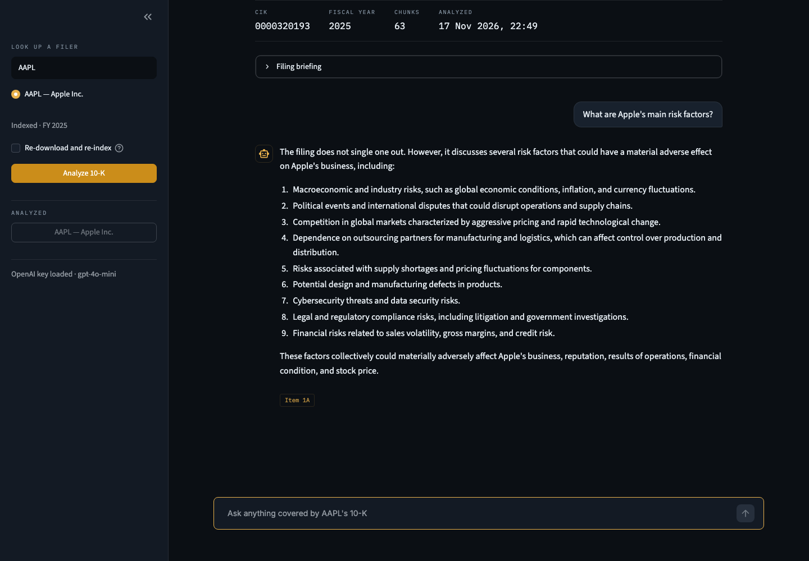
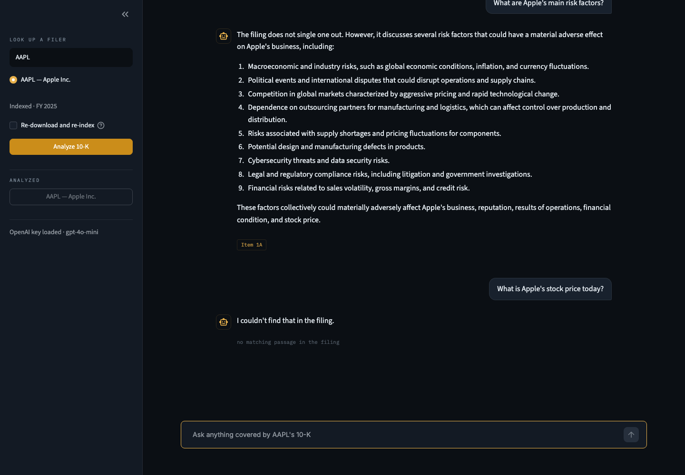

# SEC 10-K Financial Analyzer

Retrieval-augmented analysis of SEC annual reports. Pulls a company's most recent 10-K from EDGAR, splits it into its statutory items, embeds it locally, and answers questions using only what the filing says.

## Demo



*A question about Apple's 10-K, answered from the filing with the source item (Item 1A) cited.*



*A question the filing can't answer (today's stock price) is declined instead of guessed.*

## What it does

- Downloads the latest 10-K for any EDGAR filer by ticker, name, or CIK
- Segments the filing into Regulation S-K items (Item 1, 1A, 7, 8, ...)
- Embeds each item separately so retrieval carries section provenance
- Generates four analyst sections: business, risks, financials, tone
- Answers free-form questions with the source item cited on every response


## Stack


| Layer      | Choice                   | Why                                                 |
| ---------- | ------------------------ | --------------------------------------------------- |
| Retrieval  | LangChain + Chroma       | Local persistence, no vector-DB service to run      |
| Embeddings | `text-embedding-3-small` | Cheap enough to embed a full 10-K (~60-530 chunks) |
| Generation | `gpt-4o-mini`            | 128k context absorbs an entire risk-factors section |
| Parsing    | BeautifulSoup + regex    | Filings are inline-XBRL HTML, not clean documents   |
| Interface  | Streamlit                | Fast to iterate; the analysis is the product        |


## Setup

```bash
git clone <repo> && cd sec-financial-analyzer
python -m venv .venv && source .venv/bin/activate   # Windows: .venv\Scripts\activate
pip install -r requirements.txt
cp .env.example .env      # then fill in your keys
streamlit run app.py

```

`SEC_EMAIL` must be a real address. EDGAR's fair-access policy requires a contact on every request and will rate-limit anonymous traffic. All three values are documented in `.env.example` (`OPENAI_API_KEY`, `SEC_COMPANY_NAME`, `SEC_EMAIL`).

## Cost

Roughly **$0.015-0.023 per company** on the first run: about $0.013 for the four report calls and $0.002-0.010 to embed the filing. Re-opening a company that is already indexed costs nothing, and each question is about $0.001.

## The hard part: splitting the filing

A 10-K has a fixed legal structure and no formatting convention. Headings turn up as `Item 1A.`, `ITEM 1A`, `Item 1A —`, sometimes with no delimiter at all. Three problems come before retrieval can work:

1. **The table of contents duplicates every header.** Naively slicing between headers assigns the TOC's stub text to the real sections.
2. **Cross-references look like headers.** `"see Item 1A. Risk Factors"` in the middle of Item 2 is indistinguishable from a section start by pattern alone.
3. **Not every filer punctuates.** A parser that requires a trailing period silently returns zero sections for a large fraction of filings.

How it's handled — the parser chooses a strategy per filing instead of assuming every 10-K writes `Item 7.`:

- Match the item number *and* check for its Reg S-K title in the next 120 characters. That removes most false matches on its own. Titles are matched with whitespace removed, so letter-spaced headings (filings often render `RISK FACTORS` as `RIS K FACTORS`) still register.
- Drop mentions that are references, not headings. A reference continues a sentence: it follows a lowercase word or a comma (`see Item 1A`, `refer to Part II, Item 7.`, `in " Item 8. Financial Statements "`) or is followed by a quote or `of this Form 10-K` (`Item 8, “Financial Statements…”`). A real heading follows a page number, a period, or `PART II`. Apple's 10-K is the case that forced this: a reference to "Item 8" in the first paragraph of Item 1A had been taken as the start of Item 8, so the risk factors were indexed as financial statements.
- Keep one start per item: the occurrence with the most text before the next header. Table-of-contents entries are trailed almost immediately by the next header, so they lose to the real section.
- Check the result against the order items must appear in (1, 1A, 1B … 7, 7A, 8). Any pick that lands out of sequence is re-picked from the occurrences between its in-order neighbours. Before this and the reference rule above, Caterpillar, Coca-Cola, Bank of America, Visa and Walmart also had at least one key item starting in the wrong place.
- If a key item is still only a stub, search for its statutory title in the body (e.g. "Management's Discussion and Analysis" with no "Item 7" in front of it, or the auditor's report for statements printed after Part IV) and use that as the start. Mentions inside an earlier real section are ignored, so a reference to the MD&A in Item 1 does not become a fake Item 7.
- If that still cannot recover three substantial key items, cut on the titles themselves (`OVERVIEW`, `RISK FACTORS`, MD&A / `FINANCIAL REVIEW`, `CONSOLIDATED FINANCIAL STATEMENTS`) and skip TOC lines that are only followed by a page number (Citigroup).
- If a key item is still thin, read Exhibit 13 (or a large Exhibit 99) next to the 10-K and keep the longer copy of each item (Wells Fargo).
- Fall back to indexing the whole document rather than returning nothing, and show that in the UI instead of failing quietly.

Run `python test_parsing.py` to check the parser against a range of real filers (a bank, an industrial, a REIT, a holding company) before demoing. Testing only against Apple will make this look far more robust than it is.

### Test results

Two suites, testing different things:

**`test_segmentation.py`** — 8 synthetic filing shapes, covering each failure mode above individually (no periods, no TOC, cross-references, untitled MD&A, Citi-style no-item-labels, annual-report exhibits, a late cross-reference designed to out-gap the real section). Runs offline, no network, no API key.

```
8/8 filing shapes parsed correctly
```

**`test_parsing.py`** — 12 real filers pulled live from EDGAR: tech, a beverage company, an industrial, four banks with different filing conventions, a retailer, energy, a REIT, and a holding company. No embedding, no OpenAI calls.

```
ticker   year    chars       items  status
AAPL     2025    206,727     23     ok
KO       2026    600,630     23     ok
CAT      2026    433,392     23     ok
JPM      2026    1,177,213   22     ok
GS       2026    1,092,491   21     ok
BAC      2026    880,149     23     ok
C        2026    1,159,193    4     ok
WFC      2026     89,078     23     THIN: Item 1A, Item 7, Item 8 under 3k chars
WMT      2026    359,252     23     ok
XOM      —              —     —     ERROR: no 10-K on file for this ticker
PLD      2026    450,240     23     THIN: Item 1 under 3k chars
BRK-B    2026    490,597     22     ok

9/12 parsed cleanly
```

The three flagged tickers are known limits, not silent failures:

- **WFC** — Wells Fargo's Item 1A/7/8 content lives almost entirely in the Exhibit 13 annual report, not the primary 10-K document. The parser's Exhibit 13 fallback recovers some of it, but the primary document itself is genuinely thin, so the stub-detection note in the UI is doing its job rather than hiding a bug.
- **PLD** — a REIT's Item 1 business description is often only a few paragraphs by nature (there isn't much to say beyond "we own and operate industrial real estate"). This is a real thin section, not a parsing miss.
- **XOM** — not a parsing failure at all; the downloader raised `FileNotFoundError` before segmentation ever ran, most likely a ticker or filing-availability issue on that pull rather than a fault in the parser.

The synthetic suite validates the parsing *logic* against failure modes designed in advance. The real-filer suite is what actually derisks a demo, and the gap between 8/8 and 9/12 is the honest measure of how far synthetic tests generalize to messy real documents.

## Evaluation

`eval_questions.json` holds 80 questions over four filings, picked because each uses a different layout: Apple (standard), JPMorgan (untitled MD&A), Citigroup (no "Item" labels), Wells Fargo (Exhibit 13). Per company there are 17 answerable questions (exact figures, explanations, and vague ones like "what is the biggest disclosed risk?") and 3 the system must refuse (stock price today, another company, voting advice).

Labels are at the answer level. A retrieved chunk only counts as relevant if it contains a sentence or figure copied from the filing, not merely because it comes from the right item. A section-level label would have scored the "biggest risk" failure below as a hit.

```bash
python evaluate.py -v            # retrieval + answers, plain search vs. routed
python evaluate.py --no-answers  # retrieval only, no chat calls
```

Results (routed is what the app runs: the opening chunks of the item a question maps to, plus the 6 nearest chunks):

| Retrieval | Recall@6 | Context recall | MRR | False refusals | Answer accuracy | Must-refuse declined |
| --------- | -------- | -------------- | --- | -------------- | --------------- | -------------------- |
| Plain top-6 | 0.67 | 0.67 | 0.44 | 15% | 79% | 100% |
| Routed      | 0.90 | 0.92 | 0.65 | 6%  | 93% | 100% |

What the eval caught while it was being built:

- **A mislabelled filing.** Apple's risk factors were indexed as Item 8 (see the parser section). The size-based parse check called it clean. After the fix, Apple's routed Recall@6 went from 0.78 to 0.92.
- **A prompt regression.** A follow-up prompt added to stop false refusals on "biggest risk" questions also forced an answer to "What was Apple's revenue?" asked of JPMorgan's filing, and it answered with JPMorgan's numbers. The follow-up now keeps the refusal for other companies and unanswerable questions.

Where it still fails (routed): four questions whose fact sits in a chunk that neither routing nor vector search returns (Citi's country count, Wells Fargo's asset cap, Apple's direct/indirect sales split, Citi's firm-wide operating expenses, where the model quoted a segment figure instead), and one where the right table was retrieved and the model still refused (Wells Fargo ROTCE).

Answers are graded by string match against the expected figure, with millions restated as billions accepted. That is deterministic and cheap, but it cannot judge open-ended answers, which are only checked for not refusing. With 17 questions per company, one question moves a per-company score by 6 points, and repeated runs differ by a question or two.

## Grounding decisions

- **The report is not fed back into Q&A.** An earlier version passed the summaries in as extra context. That let the model answer from its own prose while the sources still pointed at retrieved chunks, so a made-up figure looked sourced.
- **Re-indexing replaces instead of appending.** Otherwise last year's vectors sit alongside this year's and retrieval blends two filings.
- **Truncation is reported.** Long risk sections get cut to fit the context window, and the UI shows how much was actually read.


## Known limits

- Segmentation is heuristic. A filing with no usable headings and no annual-report exhibit still falls back to whole-document mode.
- Some items are genuinely short (Part III pointers to the proxy, a stub Item 8 when the statements sit inside the MD&A). The UI flags those so a thin answer is not mistaken for a full one.
- Some tickers have no 10-K at all (new holding companies, foreign issuers that file a 20-F). That is an EDGAR gap, not a parse miss.
- Only the single most recent 10-K per company. No year-over-year comparison.
- Financial figures come from narrative text, not XBRL facts, so they inherit whatever the MD&A chose to state. The structured data in the filing's XBRL exhibits would be more reliable and is the obvious next step.
- The evaluation covers four filings and 80 questions. It is enough to compare retrieval strategies and catch regressions, not to claim an accuracy figure for 10-Ks in general.


## Layout

```
downloader.py     EDGAR fetch + company index
processor.py      HTML cleaning, item segmentation, chunking
vectorstore.py    Chroma persistence, indexing, coverage stats
analyzer.py       Report generation and grounded Q&A
app.py            Streamlit interface
evaluate.py       Recall@6, MRR, refusal and accuracy scoring
eval_questions.json  Labelled questions for AAPL, JPM, C, WFC
test_parsing.py   Multi-ticker parser validation
test_segmentation.py  Synthetic filings for the segmentation rules

```
